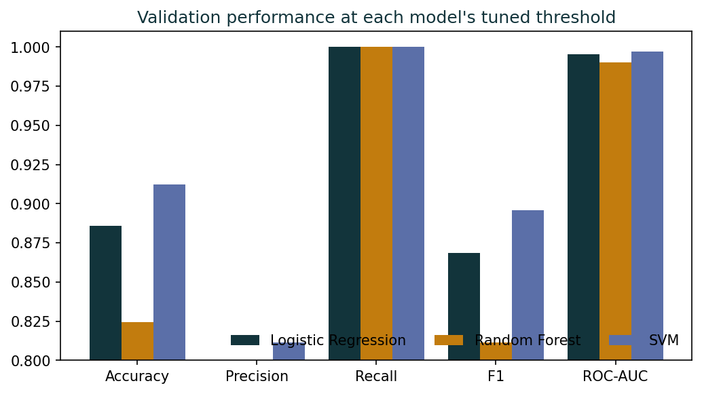
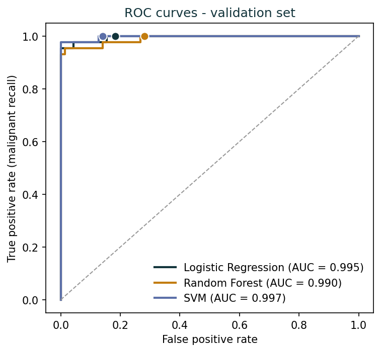
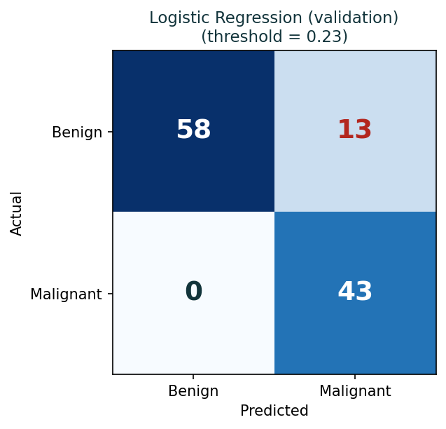
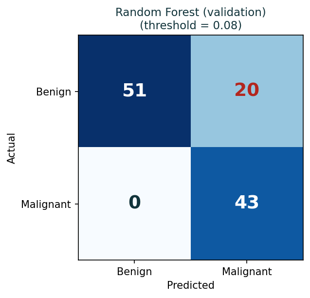
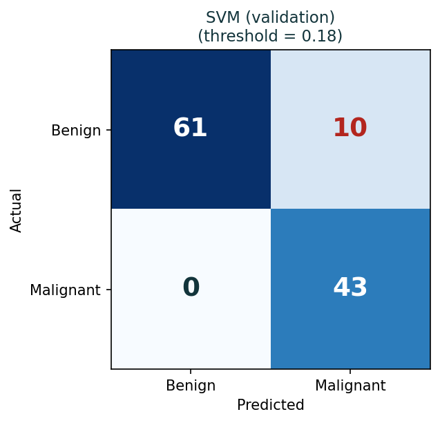
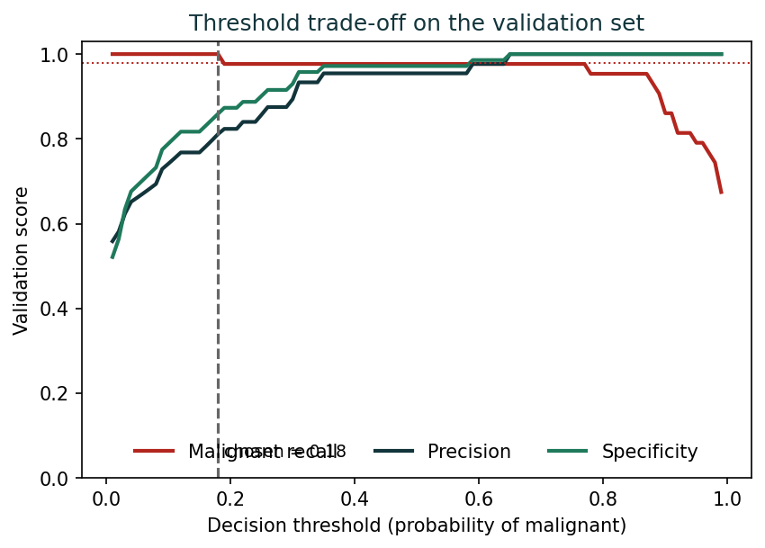
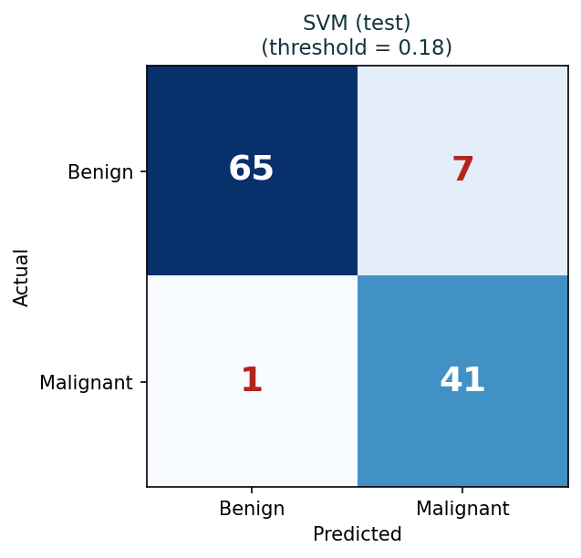
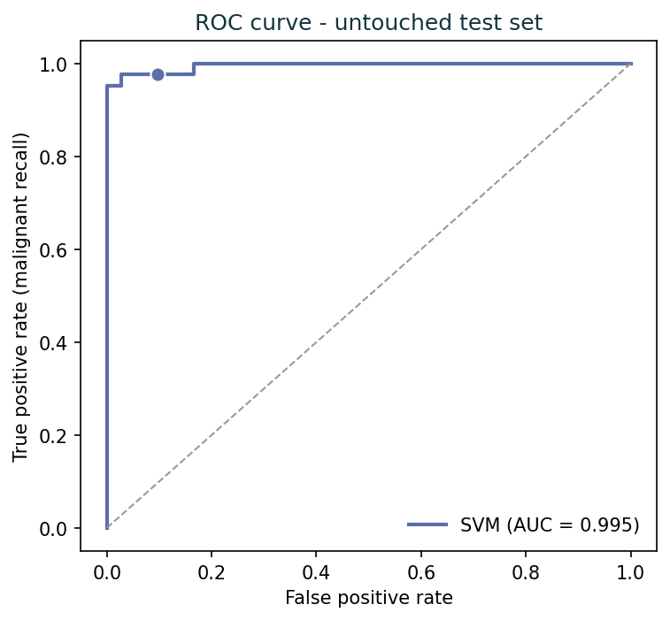
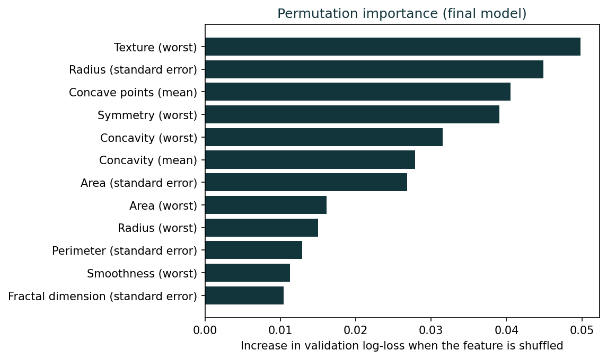

# Model report - Breast Cancer Detection

_All numbers below are produced by `python -m src.train` (random seed 42). Re-running regenerates this file._

## 1. Data and protocol

- Samples after cleaning: 569 ({'Benign': 357, 'Malignant': 212}).
- Stratified split: train 341, validation 114, test 114.
- Scaling is inside each scikit-learn Pipeline, so it is fitted on training folds only (no leakage).
- Hyper-parameters tuned with GridSearchCV (5-fold stratified CV, training set only), optimising F2 (recall-weighted).
- The decision threshold is chosen on the validation set: the highest-precision threshold with malignant recall >= 0.98.
- The test set is used once, for the final model only.

## 2. Model comparison (training CV and validation)

| Model | CV F2 | CV ROC-AUC | Threshold | Val acc | Val prec | Val recall | Val F1 | Val ROC-AUC | Val FN |
|---|---|---|---|---|---|---|---|---|---|
| Logistic Regression | 0.962 | 0.993 | 0.230 | 0.886 | 0.768 | 1.000 | 0.869 | 0.995 | 0 |
| Random Forest | 0.934 | 0.985 | 0.080 | 0.825 | 0.683 | 1.000 | 0.811 | 0.990 | 0 |
| SVM | 0.964 | 0.993 | 0.180 | 0.912 | 0.811 | 1.000 | 0.896 | 0.997 | 0 |

Validation confusion matrices (each model at its own tuned threshold):

**Selected model: SVM.** Rule: highest validation precision subject to recall >= target, ties broken by validation ROC-AUC. With only 114 validation cases, differences between models are small and should not be over-interpreted.

## 3. Threshold selection

Chosen threshold: **0.18** (default would be 0.50). Validation at this threshold: recall 100.0%, precision 81.1%.

## 4. Final evaluation on the untouched test set

| Metric | Value | 95% bootstrap CI |
|---|---|---|
| Accuracy | 0.930 | 0.877 - 0.974 |
| Precision | 0.854 | 0.733 - 0.948 |
| Recall (malignant) | 0.976 | 0.921 - 1.000 |
| F1-score | 0.911 | 0.833 - 0.966 |
| ROC-AUC | 0.995 | 0.984 - 1.000 |

Confusion matrix (n = 114): TN = 65, FP = 7, FN = 1, TP = 41.

The test set has only 42 malignant cases, so each missed case changes recall by several percentage points; the bootstrap intervals show how wide the uncertainty really is.

## 5. False-negative analysis (test set)

1 malignant case(s) were missed. Their predicted malignant probabilities: 0.070.

Closest calls (including the misses):

| Sample index | Malignant probability |
|---|---|
| 73 | 0.070 |
| 205 | 0.447 |
| 190 | 0.564 |
| 99 | 0.594 |
| 39 | 0.647 |

Median values of the most important features:

| Feature | Benign median | Malignant median | Missed-case median |
|---|---|---|---|
| Texture (worst) | 21.92 | 28.55 | 20.86 |
| Radius (standard error) | 0.2555 | 0.5355 | 0.2787 |
| Concave points (mean) | 0.02381 | 0.08057 | 0.05069 |
| Symmetry (worst) | 0.2611 | 0.3063 | 0.2589 |
| Concavity (worst) | 0.1344 | 0.3986 | 0.2779 |

Interpretation: compare the missed-case column with the benign and malignant medians. Values nearer the benign median indicate an atypical malignant presentation that the model finds hard to separate. A false negative is the costly error in screening, which is why the threshold is tuned for recall rather than accuracy.

## 6. Feature importance

## 7. Limitations

- 569 samples from one source; no external validation set.
- Features are lab measurements from fine-needle-aspirate images, not raw images.
- Threshold and model were selected on a small validation set.
- Educational project - not a medical device.
